# 朝夕 Tide

> 个人试用中，持续迭代

产品定位：整合日程待办、长期规划、日程安排、记账功能的效率工具。同时支持 Mac 和 iPhone 使用，且可同步数据。

我负责产品（想清楚做什么、试用、提修改意见），AI 编程助手 [Claude Code](https://claude.com/claude-code) 负责写代码。从写下第一版产品方案到两端都能日常使用，共用 10 天。

https://github.com/user-attachments/assets/ab4e8d4b-a093-4ad0-a979-45fb4e2e90b7

⬇ [下载 Mac 试用版](https://github.com/tongyulin1215-spec/tide-zhaoxi/releases/latest/download/Tide-Mac-Demo.zip)

---

## 为什么做

制作朝夕前习惯使用 iOS 自带工具及部分主流日程工具，遇到痛点如下：

- **功能零散**：待办、记账、总结分在不同的 App 里。
- **看不清今天**：无法直观查看每日待办。
- **越记越乱**：想到什么都记，过期的一直堆着。
- **没有反馈**：做完缺少总结，没有反馈，慢慢就不想打开了。

所以朝夕只追求三件事：**一眼看清今天、计划收得住、所有记录在一个app**。总原则是：复杂的东西藏起来，平时看到的始终简单。

## 主要功能

### 首页：一眼看清今天
今天的待办默认按优先级排好（可更改排序偏好），远期的截止事项折叠起来，勾掉一条，完成率跟着涨。过期没做的会提示「拖延」，可以一键改到今天或换个日期。

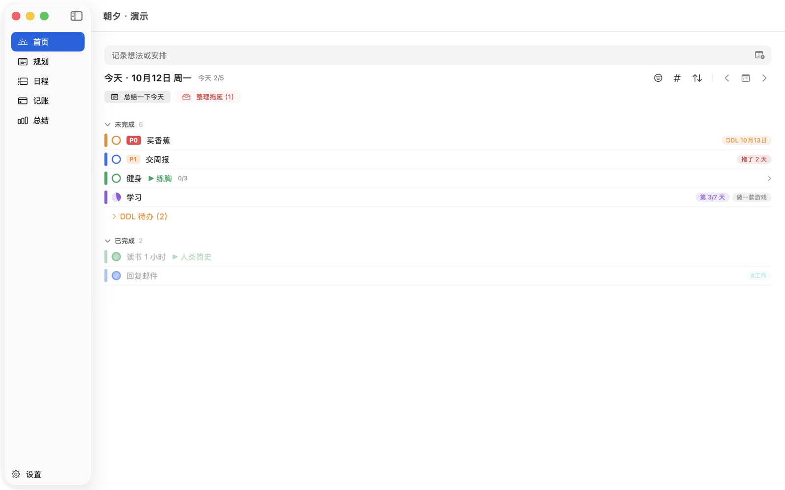

### 一句话记录，自动整理
输入简单的待办描述，比如「后天 买生日礼物 #生活」「10月15日前交报告 P1」「从10.13开始，每天背单词半小时」，日期、截止日、优先级、标签和重复规则都会自动识别。

### 规划：长期计划拆到每天
按类型建模块组：
- **循环**：比如健身，周一练胸、周二练背，每天自动排好当天的内容；
- **清单**：比如读书，列出读书清单（读完后还可为对应书籍附上感想随笔）；
- **阶段**：比如「做一款游戏」，分成学习、上手等阶段，每段有起止日期。

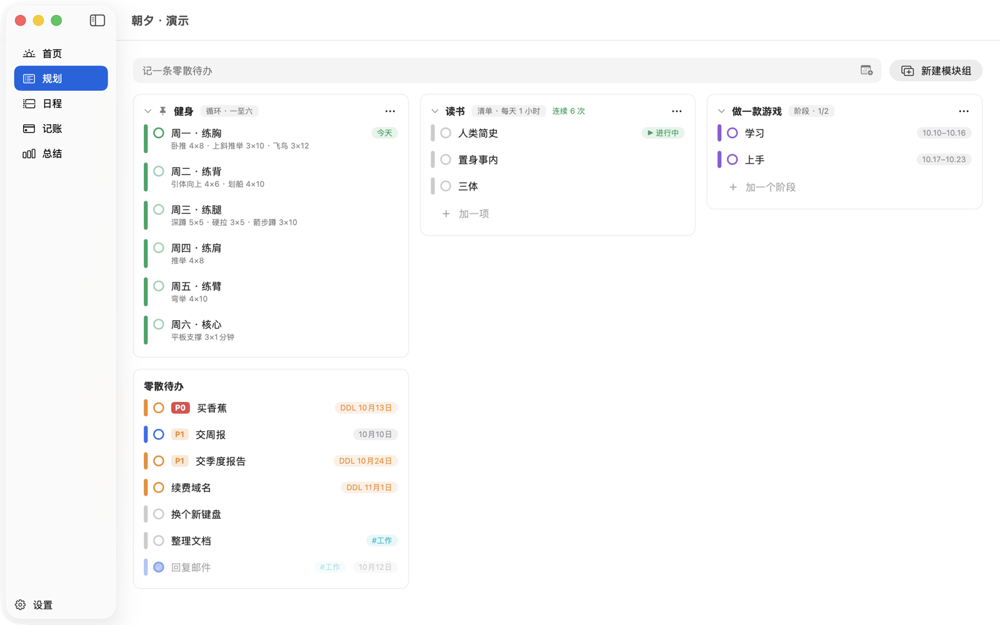

### 日程：待办直接排进时间
把右侧的待办拖进周视图，或者在空白处拖出一段新建日程，拖动可调整时间。

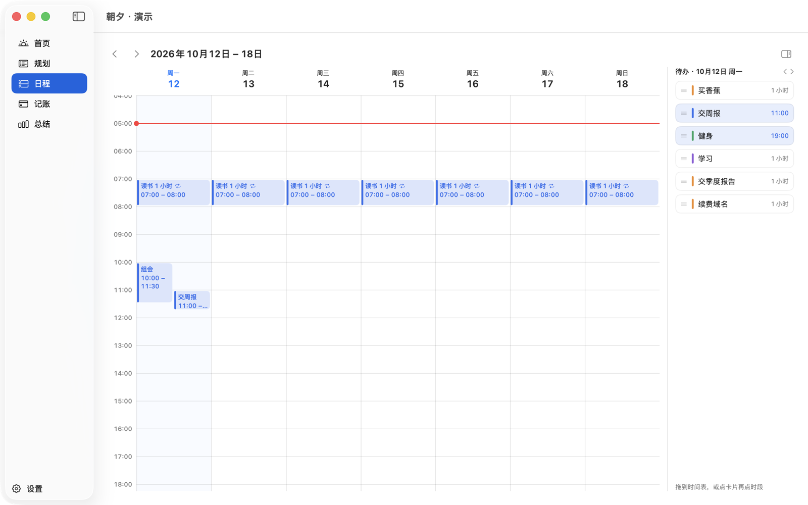

### 记账：一句话或一张截图
输入「午饭 35」就记好一笔。或粘贴付款截图，会自动识别金额和事项，确认后入账。

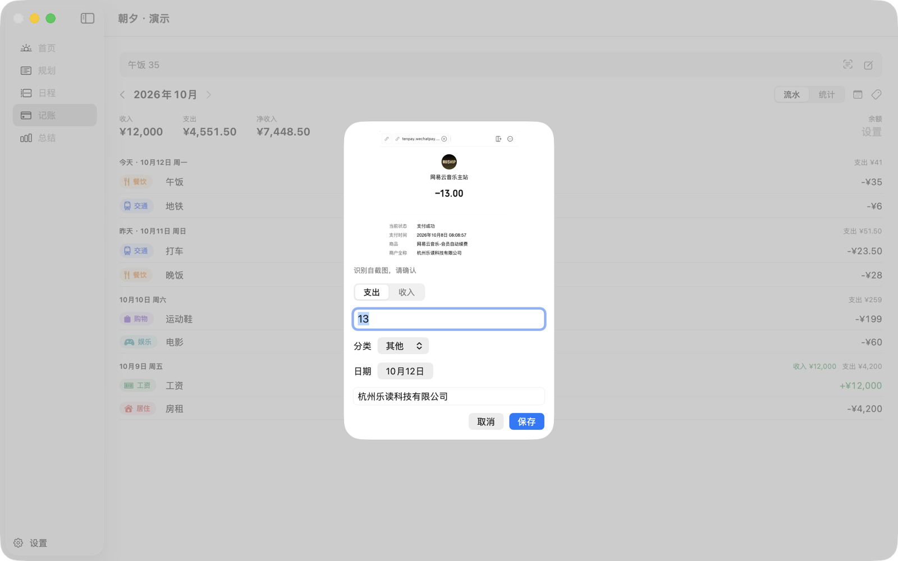

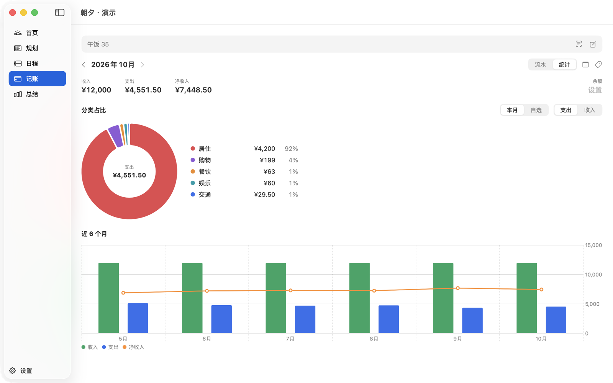

### 总结：一键复盘
首页一键「总结一下今天」。也可以自己选范围（全部、某个模块组或标签）、时间段和统计项，存成模板，下次一点就生成。这部分还在打磨，见文末「下一步迭代」。

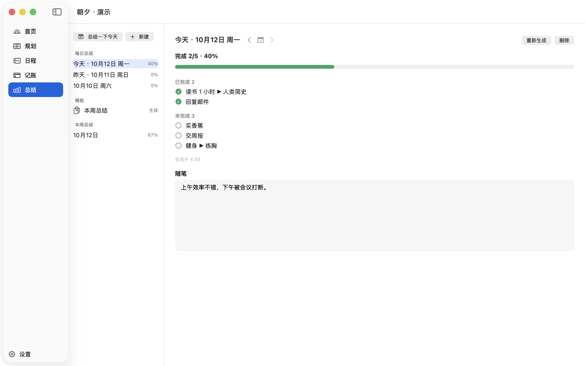

### 桌面小组件
不打开 App 也能看到今天要做什么，在小组件里可以直接勾选、按标签筛选。（图里是示例数据。）

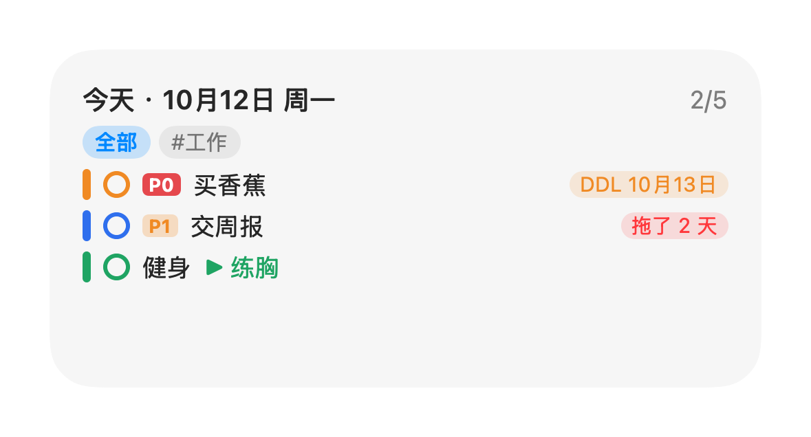 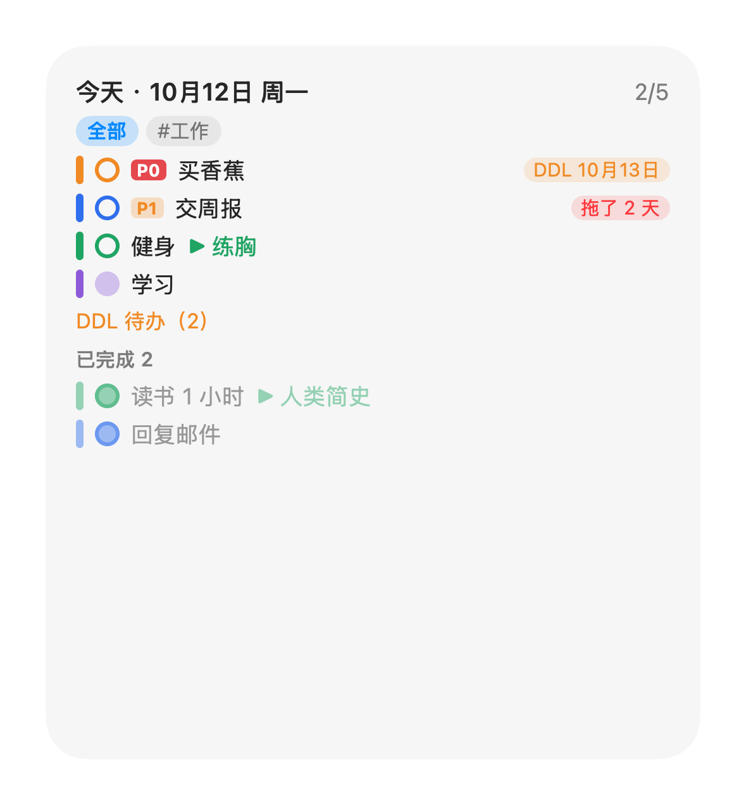

### iPhone 版
界面按手机重新设计，功能与 Mac 版一致。手机和 Mac 连在同一个无线网络时会自动同步，数据只保存在自己的设备上，不经过任何服务器。

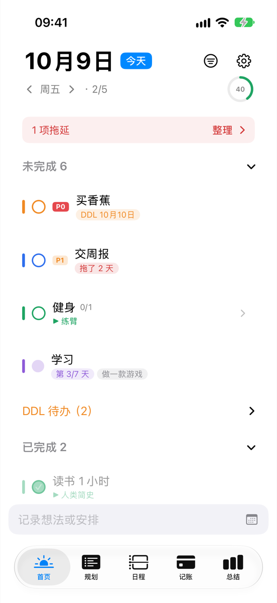 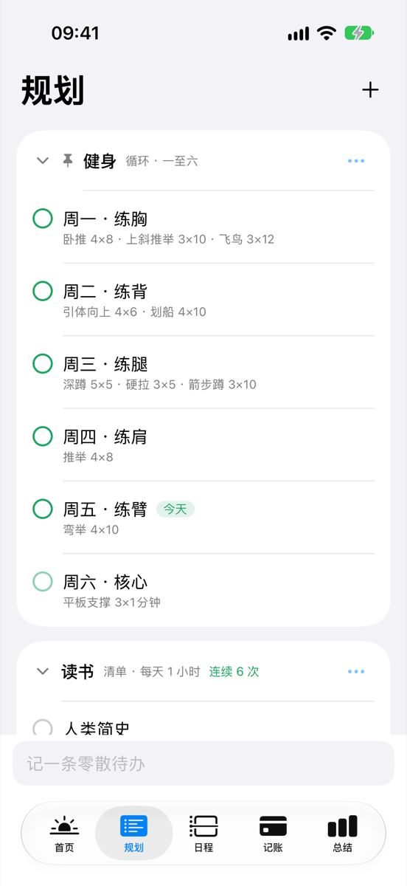 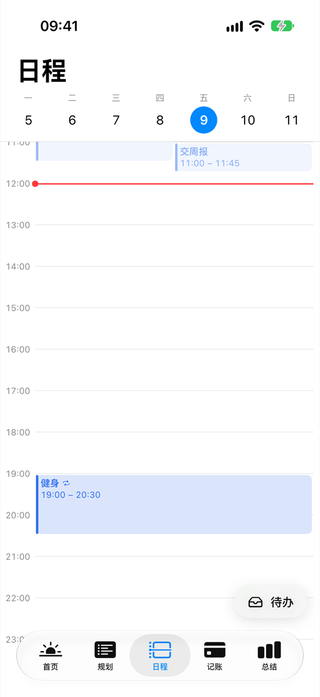

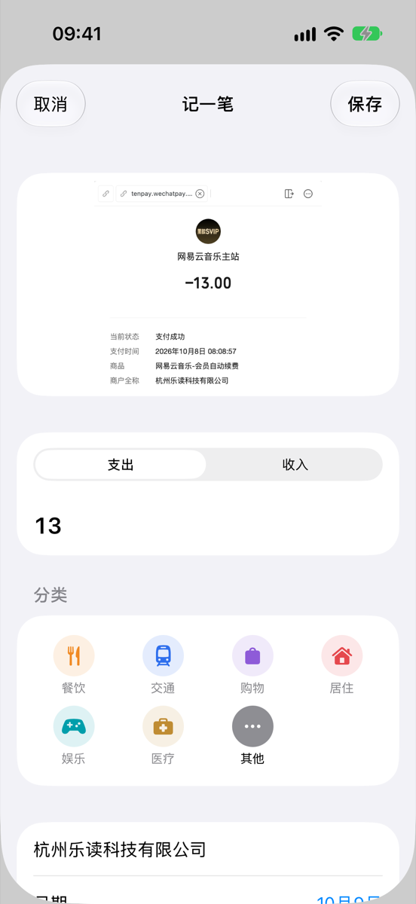 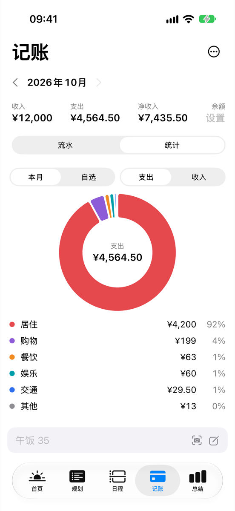 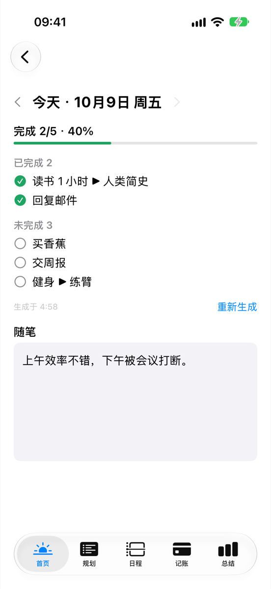

---

## 怎么用 AI 做出来的

| | |
|---|---|
| 时间 | 2026 年 10 月 3 日写下产品方案，10 月 12 日两端完成 |
| 分工 | 我：产品方向、取舍、试用反馈；AI：方案细化、写代码、测试、自查 |
| 过程文档 | 3 份产品方案、6 份开发计划、8 份界面审查记录，都在 [`docs/开发过程`](docs/开发过程) |
| 开发记录 | 原开发仓库约 130 次提交（公开时合并为一次） |
| 代码 | 约 1.28 万行 Swift |
| 自动测试 | 251 个逻辑测试 + 37 个界面测试 |

每一轮都按同样的流程走：

1. **先聊清楚**：我说想要什么，AI 一个个问题追问，整理成产品方案，我确认后才动手。
2. **写开发计划**：把方案拆成可以单独验证的小任务。
3. **测试先行**：每个功能先写自动测试，再写实现。
4. **独立审查**：一轮开发结束，另起一个 AI 审查全部改动，查出的重要问题修完再交给我。
5. **我来试用**：装到自己的 Mac 和手机上每天用，把不顺手的地方提回去，进入下一轮。

## 我对 AI 工具的观察

> 以下是我做这个项目的一些体会，会随使用不断更新。

1. **门槛从「会不会写代码」变成「能不能想到idea，能不能说清楚idea」。** 我不会写 Swift，但能做出两端可用的 App。真正花时间的，是想清楚每个功能为谁、解决什么问题，以及哪些不做。
2. **流程比单条提示词重要。** 先写方案、再拆计划、测试先行、独立审查，这套流程让结果稳定、可以验收。
3. **AI 会替你做很多默认决定，需要人逐条把关。** 只把AI的默认决定当作建议，自己进行判断和决策。比如提醒时间、统计口径、识别后是否直接入账。AI会把这些列出来，但取舍还是自己来决定。
4. **体验问题仍然要靠人。** 手势顺不顺手、界面看着舒不舒服，AI 无法亲自感受。日程页的拖动手势就是我在手机上反复试用、提了两轮意见才改好的。
5. **做一个只给自己用的软件，成本已经很低。** 以前不值得开发的小众需求，现在一个人花几天就能做出来。我觉得接下来的价值会更多在于找准需求、获得用户和积累数据，而不在于写代码本身。

---

## 下载试用（Mac）

点 [下载 Tide-Mac-Demo.zip](https://github.com/tongyulin1215-spec/tide-zhaoxi/releases/latest/download/Tide-Mac-Demo.zip)，解压后得到「朝夕」。试用版的特点：

- 每次打开都是一套全新的示例数据，可以随便点、随便改；
- 不同步、不联网，不读取电脑上的任何其他数据；
- 支持 macOS 14 及以上，Apple 芯片和 Intel 都能用。

因为没有付费的苹果开发者签名，第一次打开要手动放行：

**1.** 双击「朝夕」，提示无法验证，点「完成」。

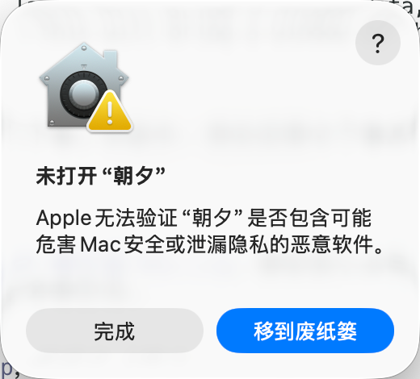

**2.** 打开「系统设置 → 隐私与安全性」，往下找到「已阻止"朝夕"」，点「仍要打开」。

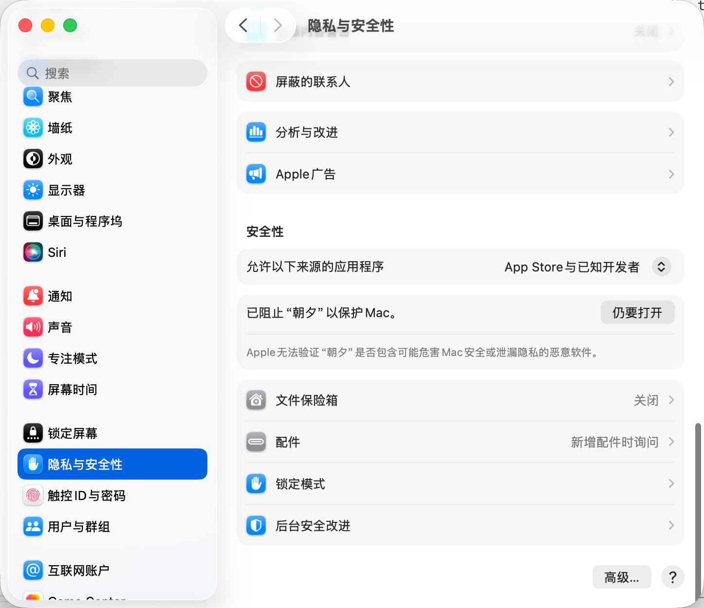

**3.** 再次弹窗时，点「仍要打开」。

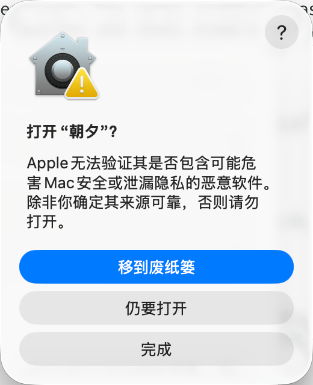

**4.** 输入开机密码或用触控 ID 确认，之后就能正常打开了。

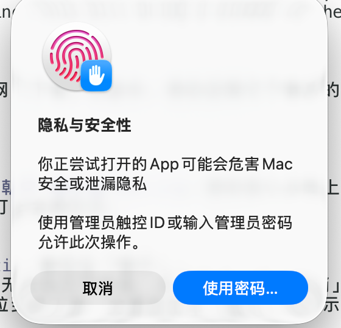

## iPhone 版

没有上架 App Store，需要用 Mac 上的 Xcode 自己编译安装：

1. 安装 Xcode 和 [XcodeGen](https://github.com/yonaskolb/XcodeGen)（`brew install xcodegen`）。
2. 在 `apps/Cre` 目录运行 `xcodegen generate`，打开生成的 `Cre.xcodeproj`。
3. 把 `project.yml` 里的开发团队和 App 标识换成你自己的，选择 `TideMobile`，连接手机运行。

免费的苹果账号签名有效期是 7 天，到期后重新运行一次即可。

## 技术结构

- **语言和框架**：Swift、SwiftUI；macOS 14 / iOS 17 起。
- **`apps/Cre/Sources/CreCore`**：两端共用的核心逻辑（待办、规划、日程、记账、总结、一句话解析、同步合并），不依赖界面，全部有自动测试。
- **`Sources/Cre`**：Mac 版界面；**`Sources/Mobile`**：iPhone 版界面；**`Sources/Shared`**：两端共用的界面组件。
- **小组件**：Mac 和 iPhone 各一个（WidgetKit），iPhone 还有锁屏小组件和控制中心按钮。
- **截图识别**：用系统自带的文字识别（Vision），在本机完成。
- **同步**：同一局域网内用 Bonjour 互相发现，首次需要输入 4 位配对码；每条记录按修改时间合并，删除也会同步。
- **数据**：存成本机的 JSON 文件，Mac 首次同步前会自动备份。

## 下一步迭代

**总结页**（优先）。用示例数据生成「本周总结」后，发现这些不足：

内容

1. 「平均用时」算的是从记下到勾掉隔了多久，不是实际花的时间，看了容易困惑。
2. 今天还没结束，就把今天算进了「没做」。
3. 「重复」和「按模块组」两栏内容重复。
4. 「未完成的日子」逐个罗列日期，太长，一句「本周 5 天都没做」就够了。
5. 只有数字，没有一句话的结论，也没有和上周对比。
6. 只统计了待办，没有汇总这段时间的花销、日程时长和随笔。
7. 阶段性计划（比如「做一款游戏」走到了哪个阶段）没有体现。

机制

8. 总结是生成那一刻的快照，之后补勾不会更新。
9. 每点一次模板就多生成一份，同一周会堆出好几份重复的报告。

**其他**
- 截图识别目前只用模拟截图和少量真实微信截图测试过，支付宝、银行等格式还要继续收集。
- 深色模式需要在真机上再检查一遍。

---

## English summary

**Tide (朝夕)** is a personal productivity app for Mac and iPhone that keeps todos, long-term plans, a weekly schedule, expenses and reviews in one place. It is in personal daily use and still being iterated.

I acted as the product manager; the code was written by the AI coding assistant Claude Code. It went from the first product spec to two working apps in 10 days. The work followed a fixed loop: spec, implementation plan, test-first development, independent AI review, then my own daily use and feedback. The result is about 12.8k lines of Swift, with 251 logic tests and 37 UI tests. Specs, plans and design reviews are in `docs/`.

Highlights: natural-language input (dates, deadlines, priority, tags, repeats), plan templates that break long-term goals into daily tasks, drag-to-schedule, expense entry from a payment screenshot (on-device OCR), one-click reviews, desktop widgets, and peer-to-peer sync over the local network with no server.

A Mac trial build with sample data is available under Releases. The iPhone app must be built with Xcode.
